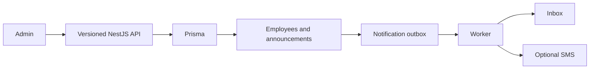

# Versioned HR Platform API

[](https://github.com/yashybm30/hr-platform-api/actions/workflows/ci.yml)

An independently runnable portfolio project demonstrating prisma postgresql schema and repeatable migration.

## Implemented behavior

- Prisma PostgreSQL schema and repeatable migration
- Tenant-admin employee provisioning and member self-view
- Version 1 legacy arrays and version 2 paginated envelopes
- Transactional announcements and per-user notification outbox
- Retrying delivery worker with optional Twilio SMS and terminal failure state

## Architecture



## Requirements and setup

Node.js 24 and npm. Docker Engine with Compose v2 is needed for local databases/queues. Native browser scraping also requires Chromium. Exact dependencies and reproducible versions are in package.json/package-lock.json.

```bash
npm ci
npm run check
```

```bash
cp .env.example .env
# Edit the environment before starting; use random independent signing secrets.
docker compose --env-file .env up --build -d
```

Run one stack at a time because localhost development ports overlap. For native execution, run `npm run build`, start the documented dependencies, apply migrations where applicable, then `npm start`. Node reads `.env` for the start and SQL migration scripts; Vitest requires exported test environment variables. Bash examples use `NAME=value command`; PowerShell uses `$env:NAME='value'` before the command.

Prisma migrations: `npm run db:migrate`. Use `DATABASE_URL` with an optional `?schema=...` parameter for schema isolation. `npm ci` generates the Prisma client. Production needs a restricted runtime database role and a separate migration role.

## Configuration

- `PORT`: HTTP port (default 3000).
- `JWT_SECRET`: at least 48 random characters; match the trusted issuer when using auth-service tokens.
- `JWT_ISSUER` / `JWT_AUDIENCE`: default `portfolio-auth` / `portfolio-api`.
- `CORS_ORIGIN`: comma-separated browser origins, deny cross-origin by default.
- `REDIS_URL`: local Redis connection where applicable.
- `DATABASE_URL`: PostgreSQL connection, with credentials injected outside source control.
- `TWILIO_ACCOUNT_SID`, `TWILIO_AUTH_TOKEN`, `TWILIO_FROM`: optional SMS provider configuration.

## Usage and contracts

| Method | Endpoint | Access |
|---|---|---|
| POST | `/v1/employees` `{userId,name,email,phone?}` | Tenant admin |
| GET | `/v1/employees` | Admin, legacy array (max 100) |
| GET | `/v2/employees?page=1` | Admin, `{items,total,page,pageSize}` |
| PATCH | `/v1/employees/:id` `{name}` | Admin, same tenant |
| GET | `/v1/me` | Employee record linked to JWT subject |
| POST / GET | `/v1/announcements` | Admin write; tenant read |
| GET | `/v1/notifications` | Current user's inbox |

Employee provisioning does not create identity credentials: use the auth-service subject UUID. Announcements and recipient notifications are inserted in one transaction. The worker claims pending rows with `FOR UPDATE SKIP LOCKED`, retries failures up to five times and marks exhausted deliveries failed. SMS is disabled unless `TWILIO_ACCOUNT_SID`, `TWILIO_AUTH_TOKEN`, and `TWILIO_FROM` are configured and a recipient has a phone number. In-app delivery works without Twilio.

The v1/v2 response contract change is intentional; keep clients on their chosen version. Phone numbers are never exposed by employee listing endpoints. Use a restricted migration/runtime role split and encryption/retention rules for real employee data.

### Authentication and health

Authenticated HTTP examples use `Authorization: Bearer $ACCESS_TOKEN`. Obtain a correctly scoped token from your trusted issuer or the portfolio auth service using the same signing/issuer/audience settings. No production debug token endpoint is exposed. GET `/health/live` verifies the process; GET `/health/ready` checks the project's primary dependencies. `/docs` exposes route documentation; request examples here define the detailed contracts.

## Validation

```bash
npm run check
npm run test:integration  # requires actual local dependencies, where a suite exists
```

Unit tests never imply integration success. Integration suites use disposable namespaces and test signing keys; never point them at production. Tests import compiled application modules to preserve NestJS decorator metadata. See Actions for the current hosted status. External provider calls and cloud deployments are not part of local acceptance.

## Deployment and operations

The Dockerfile uses a separate build stage and a non-root runtime. Start dependencies and migrations before the application. Compose is a local development setup. For GCP/GKE or another cloud, publish a reviewed image, inject secrets using the platform secret manager, configure private dependency connectivity, health probes and resource limits, and verify graceful shutdown. No paid cloud resource is created by this repository.

## Security and trade-offs

Bearer identity is verified with an explicit JWT algorithm, issuer, audience and structured claims. Tenant IDs come from verified tokens, not headers. New services validate access-token expiry but do not introspect the authentication service for immediate token revocation; use short-lived tokens or add an introspection boundary where required. Limits and permission checks are documented per endpoint. Use TLS, workload credentials, restricted networks, backups, request quotas and least-privilege runtime roles before real deployment.

## Known limitations

Twilio delivery is unverified without provider credentials. A crash after an external SMS succeeds but before its database commit can cause redelivery; the design is at least once. No attendance, payroll, account invitations or bulk employee import is implemented.

## Roadmap

Expand failure-mode coverage, validate external integrations in a staging account, add deployment-specific telemetry and retention policy, and review action/dependency updates regularly. Features described above are implemented; this roadmap is not a completion claim.

MIT licensed. See CONTRIBUTING.md and SECURITY.md.

### Standalone development identities

For a disposable local setup without a separate identity server, set the same random `JWT_SECRET` as the API and run `npm run token:dev -- <subject-uuid> <tenant-uuid> <admin-or-member>`. The CLI prints a 15-minute token; it is disabled when `NODE_ENV=production`. Keep it in your shell session, never commit it or paste it into issues. This is a local development utility, not a public login endpoint. Production must use a trusted identity issuer.
